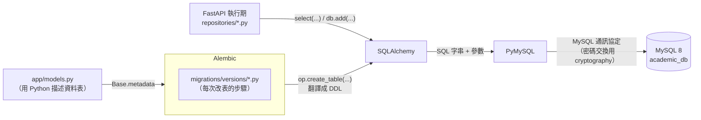
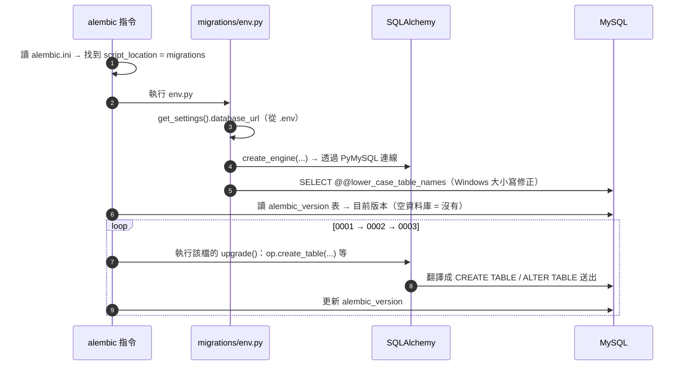
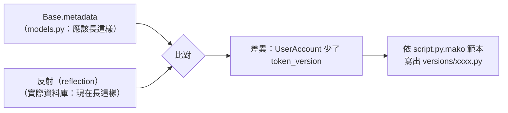
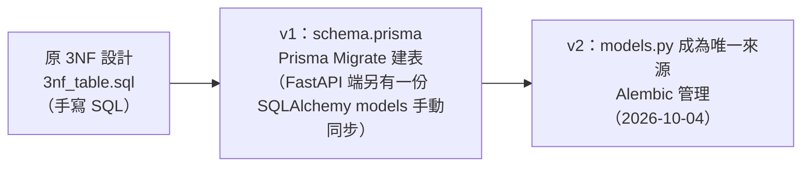

# SQLAlchemy、Alembic 與資料庫建立筆記

這份筆記說明本專案中「和資料庫有關的套件」各自在做什麼，資料庫是怎麼從零被建出來的，`api/app/models.py` 是怎麼寫、怎麼來的，以及和 v1 使用的 Prisma 差在哪裡。例子都取自本專案。

---

## 0. 一張圖看懂：誰負責什麼



| 套件／元件                  | 一句話說明                                                                           | 在本專案的位置                                           |
| --------------------------- | ------------------------------------------------------------------------------------ | -------------------------------------------------------- |
| **MySQL 8**           | 真正存資料、執行 SQL、強制約束的資料庫伺服器                                         | 本機安裝的服務；資料庫名稱`academic_db`                |
| **PyMySQL**           | 驅動程式（driver）：負責「連上 MySQL、把 SQL 送過去、把結果拿回來」                  | `requirements.txt`；`DATABASE_URL` 中的 `+pymysql` |
| **cryptography**      | PyMySQL 的相依套件：MySQL 8 預設的登入驗證方式`caching_sha2_password` 需要它做加密 | `requirements.txt`                                     |
| **SQLAlchemy**        | 把 Python 物件與 SQL 互相轉換的工具組（ORM + SQL 產生器 + 連線池）                   | `app/models.py`、`app/db.py`、`app/repositories/`  |
| **Alembic**           | 資料庫結構的版本控制：記錄「資料表怎麼一步一步變成現在這樣」並負責套用               | `alembic.ini`、`migrations/`                         |
| **pydantic-settings** | 從`.env` 讀出 `DATABASE_URL` 並驗證格式                                          | `app/config.py`                                        |

最重要的觀念：

- **SQLAlchemy 不會自己建表**，它只「描述」資料表，並負責把描述翻譯成 SQL。
- **Alembic 才是建表、改表的那一位**，而它的 migration 底層仍然靠 SQLAlchemy 產生 SQL、靠 PyMySQL 送出。
- **兩者都不會建立資料庫本身**（`CREATE DATABASE`），那一步要在 MySQL 手動做一次。

---

## 1. 從零建出資料庫：每一步是誰在做事

README 的步驟只有幾行，但背後每一行都牽涉不同套件：

```powershell
# 0. 在 MySQL 裡手動建立空的資料庫（只做一次）
CREATE DATABASE academic_db CHARACTER SET utf8mb4 COLLATE utf8mb4_unicode_ci;

# 在 api\ 下
Copy-Item .env.example .env      # 1. 填入 DATABASE_URL
alembic upgrade head             # 2. 建立資料表與 View
python -m seed                   # 3. 寫入種子資料
uvicorn app.main:app --port 8000 # 4. API 開始讀寫資料庫
```

### 步驟 0：`CREATE DATABASE`（MySQL 自己）

Alembic 與 SQLAlchemy 都需要「先連得上一個資料庫」才能工作，而連線字串裡就寫著資料庫名稱，所以空的 `academic_db` 必須先存在。這裡指定的 `utf8mb4_unicode_ci` 和 `models.py` 中 `TABLE_OPTIONS` 的設定一致。

### 步驟 1：`DATABASE_URL`（pydantic-settings）

```text
mysql+pymysql://帳號:密碼@localhost:3306/academic_db
└┬──┘ └──┬──┘
 方言    驅動
```

- `mysql`：SQLAlchemy 的**方言（dialect）**，決定產生的 SQL 要用 MySQL 的語法（例如 `TINYINT`、`ENUM`、反引號）。
- `pymysql`：要用哪一個**驅動程式**送出 SQL。同樣是 MySQL，也可以換成 `mysqlclient` 等其他驅動，models 完全不用改。
- `app/config.py` 用 `Field(pattern=r"^mysql\+pymysql://")` 驗證格式，填錯時程式一啟動就失敗，不會跑到一半才出錯。

### 步驟 2：`alembic upgrade head`（Alembic → SQLAlchemy → PyMySQL）



執行時看到的這兩行 log，意思是：

```text
INFO  [alembic.runtime.migration] Context impl MySQLImpl.
INFO  [alembic.runtime.migration] Will assume non-transactional DDL.
```

- `MySQLImpl`：Alembic 偵測到方言是 MySQL，會用 MySQL 的語法產生 DDL。
- `non-transactional DDL`：MySQL 的 `CREATE TABLE`、`ALTER TABLE` 執行後會**自動 commit**，無法 rollback。所以 migration 執行到一半失敗時，前面已建好的表會留著，要手動處理（這點和 PostgreSQL 不同）。

### 步驟 3：`python -m seed`（SQLAlchemy）

`api/seed/__main__.py` 用兩種方式寫資料：

- `db.execute(text(statement))`：把 `seed.sql` 的每一句原樣交給資料庫（SQLAlchemy 的 Core 層）。
- `UserAccount(username=..., password_hash=...)`、`t.user = UserAccount(...)`：用 ORM 物件建立帳號，SQLAlchemy 在 flush 時自動產生 `INSERT`，並把新帳號的 `user_id` 回填到 `Teacher.user_id`。

`python -m seed --reset` 會在程式裡呼叫 Alembic 的 API（`command.downgrade(cfg, "base")` → `command.upgrade(cfg, "head")`），等同手動執行兩個 alembic 指令。

### 步驟 4：API 執行期（SQLAlchemy）

`app/db.py` 建立全程式共用的 `engine`（連線池）與 `SessionLocal`。每個 HTTP 請求透過 `get_db()` 拿到一個 `Session`，repositories 在裡面查詢。這一層和「建立資料庫」無關，見 §3.6 的簡短說明。

---

## 2. MySQL、PyMySQL、cryptography：最底層的連線

| 層           | 職責                                                                                                          | 不知道的事                                        |
| ------------ | ------------------------------------------------------------------------------------------------------------- | ------------------------------------------------- |
| MySQL        | 解析 SQL、存資料、檢查約束（UNIQUE、FK、CHECK）、處理鎖                                                       | 不知道 Python 物件是什麼                          |
| PyMySQL      | 依 Python 的**DB-API 2.0** 標準介面（`connect()`、`cursor.execute()`、`fetchall()`）和 MySQL 溝通 | 不知道資料表長什麼樣子，只負責傳送 SQL 字串與參數 |
| cryptography | 提供 RSA／SHA-256 等加密運算                                                                                  | 只在登入資料庫的驗證交換時用到                    |

為什麼需要 cryptography：MySQL 8 的預設驗證外掛是 `caching_sha2_password`。在沒有 TLS 的連線上（本機開發就是這樣），伺服器重啟後的第一次登入要用 RSA 公鑰加密密碼，PyMySQL 把這段運算交給 cryptography。少了它，連線會在驗證階段失敗。

> 理論上可以只用 PyMySQL 寫整個專案：自己組 SQL 字串、自己把結果轉成 dict。SQLAlchemy 與 Alembic 解決的是「這樣寫會很累、很容易錯」的問題。

---

## 3. SQLAlchemy

### 3.1 兩層架構：Core 與 ORM

| 層             | 操作的對象                                    | 本專案的例子                                                                                                       |
| -------------- | --------------------------------------------- | ------------------------------------------------------------------------------------------------------------------ |
| **Core** | 資料表、欄位、SQL 運算式；`Engine` 與連線池 | `create_engine(...)`、`text("SELECT @@lower_case_table_names")`、`select(func.count()).select_from(Student)` |
| **ORM**  | Python 類別與物件（一個物件 = 一列資料）      | `class Section(Base)`、`db.get(Student, "S001")`、`db.add(enrollment)`、`db.commit()`                      |

ORM 建在 Core 之上：你定義 `class Section(Base)` 時，SQLAlchemy 在背後同時建立了一個 Core 的 `Table("Section", ...)` 物件。

### 3.2 `Base` 與 `metadata`：所有資料表的清單

```python
class Base(DeclarativeBase):
    """所有 ORM 模型的基底；Base.metadata 收集全部資料表，供 Alembic 比對"""
```

- 每個繼承 `Base` 的類別，在 Python 載入 `models.py` 時就會把自己的 `Table` 登記到 **`Base.metadata`**。
- `Base.metadata` 是一個記憶體中的物件，內容是「15 張資料表應該長什麼樣子」：欄位、型別、主鍵、外鍵、索引、約束。
- **它只是描述，不會連線、不會建表。** Alembic 的 `env.py` 用 `target_metadata = Base.metadata` 把這份描述拿去和真正的資料庫比對（§4.4）。

### 3.3 一張表怎麼寫：以 `Section` 為例

左邊是 `models.py`，右邊是它最後在 MySQL 產生的 DDL（取自 `api/database/schema.generated.sql`）：

```python
class Section(Base):
    __tablename__ = "Section"
    __table_args__ = table_args(
        UniqueConstraint("course_no", "semester_id", "section_code",
                         name="Section_course_no_semester_id_section_code_key"),
        UniqueConstraint("section_id", "semester_id", name="Section_section_id_semester_id_key"),
        Index("Section_semester_id_status_idx", "semester_id", "status"),
        CheckConstraint("capacity BETWEEN 1 AND 500", name="chk_section_capacity"),
    )

    section_id: Mapped[int] = mapped_column(Integer, primary_key=True, autoincrement=True)
    course_no: Mapped[str] = mapped_column(CHAR(5), fk("Course.course_no", "Section_course_no_fkey"))
    semester_id: Mapped[str] = mapped_column(CHAR(4), fk("Semester.semester_id", "Section_semester_id_fkey"))
    section_code: Mapped[str] = mapped_column(CHAR(2), server_default="01")
    capacity: Mapped[int] = mapped_column(SmallInteger)
    status: Mapped[SectionStatus] = mapped_column(_enum(SectionStatus), server_default="Open")
    created_by: Mapped[str | None] = mapped_column(
        CHAR(6), fk("Teacher.teacher_id", "Section_created_by_fkey", ondelete="SET NULL")
    )
    created_at: Mapped[datetime] = mapped_column(DateTime, server_default=NOW)

    course: Mapped[Course] = relationship()
    teachers: Mapped[list["SectionTeacher"]] = relationship(back_populates="section", cascade="all, delete-orphan")
```

```sql
CREATE TABLE `Section` (
    section_id INTEGER NOT NULL AUTO_INCREMENT,
    course_no CHAR(5) NOT NULL,
    semester_id CHAR(4) NOT NULL,
    section_code CHAR(2) NOT NULL DEFAULT '01',
    capacity SMALLINT NOT NULL,
    status ENUM('Open','Cancelled') NOT NULL DEFAULT 'Open',
    created_by CHAR(6),
    created_at DATETIME NOT NULL DEFAULT CURRENT_TIMESTAMP,
    PRIMARY KEY (section_id),
    CONSTRAINT chk_section_capacity CHECK (capacity BETWEEN 1 AND 500),
    CONSTRAINT `Section_course_no_fkey` FOREIGN KEY(course_no) REFERENCES `Course` (course_no) ON DELETE RESTRICT ON UPDATE CASCADE,
    CONSTRAINT `Section_created_by_fkey` FOREIGN KEY(created_by) REFERENCES `Teacher` (teacher_id) ON DELETE SET NULL ON UPDATE CASCADE,
    CONSTRAINT `Section_semester_id_fkey` FOREIGN KEY(semester_id) REFERENCES `Semester` (semester_id) ON DELETE RESTRICT ON UPDATE CASCADE,
    CONSTRAINT `Section_course_no_semester_id_section_code_key` UNIQUE (course_no, semester_id, section_code),
    CONSTRAINT `Section_section_id_semester_id_key` UNIQUE (section_id, semester_id)
)CHARSET=utf8mb4 COLLATE utf8mb4_unicode_ci;

CREATE INDEX `Section_semester_id_status_idx` ON `Section` (semester_id, status);
```

逐項對照：

| models.py 的寫法                                     | 產生的 SQL                                                              | 說明                                                                      |
| ---------------------------------------------------- | ----------------------------------------------------------------------- | ------------------------------------------------------------------------- |
| `__tablename__ = "Section"`                        | `CREATE TABLE \`Section\``                                            | 資料表名稱；本專案一律 PascalCase                                         |
| `Mapped[int]`、`Mapped[str]`                     | `NOT NULL`                                                            | 型別標註**沒有** `None` → 不可為 NULL                            |
| `Mapped[str \| None]`                               | （可為 NULL）                                                           | `created_by` 允許 NULL（歷史資料沒有建立者）                            |
| `mapped_column(CHAR(5))`                           | `CHAR(5)`                                                             | 括號裡寫的是**資料庫型別**；`Mapped[...]` 是**Python 型別** |
| `primary_key=True, autoincrement=True`             | `PRIMARY KEY`、`AUTO_INCREMENT`                                     |                                                                           |
| `server_default="01"`                              | `DEFAULT '01'`                                                        | 預設值寫進 DDL，由資料庫產生（見下方說明）                                |
| `server_default=NOW`                               | `DEFAULT CURRENT_TIMESTAMP`                                           | `NOW = func.current_timestamp()`                                        |
| `_enum(SectionStatus)`                             | `ENUM('Open','Cancelled')`                                            | Python 的`StrEnum` 對應 MySQL 的 ENUM                                   |
| `fk("Course.course_no", "Section_course_no_fkey")` | `CONSTRAINT ... FOREIGN KEY ... ON DELETE RESTRICT ON UPDATE CASCADE` | `fk()` 是本專案的輔助函式（§3.4）                                      |
| `UniqueConstraint(...)`                            | `CONSTRAINT ... UNIQUE (...)`                                         | 名稱明確寫出                                                              |
| `Index(...)`                                       | `CREATE INDEX ...`                                                    |                                                                           |
| `CheckConstraint(...)`                             | `CONSTRAINT ... CHECK (...)`                                          | MySQL 8.0.16 起才真正強制執行                                             |
| `relationship(...)`                                | **（沒有任何 SQL）**                                              | 只存在於 Python 端，見下方說明                                            |
| `table_args(...)` 最後附上的 `TABLE_OPTIONS`     | `CHARSET=utf8mb4 COLLATE utf8mb4_unicode_ci`                          |                                                                           |

#### `server_default` 與 `default` 的差別

| 參數                   | 誰產生預設值                | 會不會寫進 DDL        | 本專案       |
| ---------------------- | --------------------------- | --------------------- | ------------ |
| `server_default=...` | MySQL                       | 會（`DEFAULT ...`） | 全部使用這個 |
| `default=...`        | SQLAlchemy 在 INSERT 時帶入 | 不會                  | 沒有使用     |

用 `server_default` 的好處：以原始 SQL 寫入資料時（例如 `seed.sql` 的 `INSERT`，ORM 不介入），預設值一樣有效。

例外是 `Enrollment.updated_at` 的 `onupdate=func.now()`：這是 SQLAlchemy 在**透過 ORM 更新這一列時**，自動在 `UPDATE` 敘述中加上 `updated_at = now()`。直接下 SQL 更新時不會生效。

#### `relationship()` 不會產生任何 SQL

`relationship` 是給 Python 程式「順著關係走」用的，不影響資料表結構：

```python
section.course.course_name          # 從班級拿到課程名稱，SQLAlchemy 自動查 Course
section.teachers                    # 這個班的 SectionTeacher 清單
t.user = UserAccount(...)           # seed 中：指派後 flush 時自動寫入 Teacher.user_id
```

真正在資料庫中建立關聯的是外鍵（`fk(...)`、`ForeignKeyConstraint`）。`cascade="all, delete-orphan"` 也只是 ORM 的行為：從 `course.fields` 清單移除一個物件，flush 時 SQLAlchemy 會替你下 `DELETE`。這和外鍵上的 `ON DELETE CASCADE`（由 MySQL 執行）是兩回事。

### 3.4 本專案自訂的三個輔助函式

```python
def table_args(*items):
    return (*items, TABLE_OPTIONS)        # 每張表都附上 utf8mb4_unicode_ci

def fk(target, name, *, ondelete="RESTRICT"):
    return ForeignKey(target, name=name, ondelete=ondelete, onupdate="CASCADE")

def _enum(cls):
    return Enum(cls, native_enum=True, validate_strings=True,
                values_callable=lambda e: [m.value for m in e])
```

- `table_args`：SQLAlchemy 規定 `__table_args__` 若是 tuple，資料表選項的 dict 必須放在最後一個。包成函式避免每張表都要記得這條規則。
- `fk`：外鍵一律 `ON UPDATE CASCADE`，`ON DELETE` 預設 `RESTRICT`，可為 NULL 的外鍵改傳 `SET NULL`。這正好是 **Prisma 的預設行為**（必填關聯 Restrict、選填關聯 SetNull、更新一律 Cascade）。v1 由 Prisma 建出的外鍵就是這樣，v2 改寫成 SQLAlchemy 時照抄，資料庫才能完全不變（§5）。
- `_enum`：`values_callable` 讓資料庫存列舉的**值**（`"Open"`），而不是成員名稱。`validate_strings=True` 讓錯誤的字串在 Python 端就被擋下。

### 3.5 View 也寫成類別，但不由 SQLAlchemy 建立

```python
class SectionDetailView(Base):
    __tablename__ = "v_section_detail"
    __table_args__ = {"info": {"is_view": True}}
    section_id: Mapped[int] = mapped_column(Integer, primary_key=True)
    ...
```

- 寫成類別是為了**查詢方便**：`select(SectionDetailView).where(...)`、`db.get(SectionDetailView, 16)`。
- View 真正的定義是 migration 中手寫的 `CREATE VIEW ... AS SELECT ...`（`0001_init.py`、`0002_field_names.py`）。
- `info={"is_view": True}` 是給 Alembic 看的標記：比對時略過它，否則 Alembic 會以為「models 有一張叫 `v_section_detail` 的表，資料庫沒有」，然後產生 `CREATE TABLE`（見 §4.6 的 `include_object`）。

### 3.6 執行期：SQLAlchemy 如何產生查詢（簡述）

建好資料庫之後，SQLAlchemy 在 API 中負責把 Python 寫的查詢轉成 SQL：

```python
# app/repositories/student_repository.py
def lock(db: Session, student_id: str) -> Student | None:
    return db.scalar(select(Student).where(Student.student_id == student_id).with_for_update())
```

送到 MySQL 的大致是：

```sql
SELECT ... FROM `Student` WHERE `Student`.student_id = %(student_id_1)s FOR UPDATE
```

`student_id` 是以**參數**傳給 PyMySQL，而不是拼進字串，所以不會有 SQL Injection。`app/db.py` 另外設定了連線池（`pool_pre_ping`、`pool_recycle`）與隔離等級 `READ COMMITTED`，這些屬於執行期的設定，與建表無關。

### 3.7 為什麼不用 `Base.metadata.create_all()`

SQLAlchemy 本身有一個 `create_all()`，可以依 models 直接建表。本專案**禁止使用**，原因：

| `create_all()`                                                   | Alembic                                  |
| ------------------------------------------------------------------ | ---------------------------------------- |
| 只會建立「還不存在」的表；表已存在時，欄位改了也**不會修改** | 可以新增欄位、改型別、加索引……         |
| 沒有版本紀錄，不知道資料庫目前是哪個版本                           | `alembic_version` 記錄目前版本         |
| 無法還原                                                           | 每個 migration 都有`downgrade()`       |
| 不會建立 View                                                      | migration 中可用`op.execute()` 建 View |

`create_all()` 適合寫完即丟的小工具或測試，不適合需要持續改表的專案。

---

## 4. Alembic

Alembic 由 SQLAlchemy 的作者開發，定位是「**資料庫結構的 git**」：每次改表都是一個 migration 檔，按順序串成歷史；資料庫裡記著目前套用到哪一版。

### 4.1 檔案結構

```text
api/
├─ alembic.ini                 Alembic 的設定檔：migration 放在哪、log 格式（必須純 ASCII）
└─ migrations/
   ├─ env.py                   每次執行 alembic 指令都會跑的腳本：怎麼連線、拿什麼來比對
   ├─ script.py.mako           產生新 migration 檔時用的範本
   └─ versions/
      ├─ 0001_init.py          15 張表、CHECK 約束、2 個 View
      ├─ 0002_field_names.py   兩個 View 加上 field_names 欄位
      └─ 0003_token_version.py UserAccount 新增 token_version
```

`migrations/` 不是 Python 套件（沒有 `__init__.py`），由 `alembic` 指令依 `alembic.ini` 的 `script_location` 載入。詳見 `Python 模組、套件與特殊名稱.md` §5。

### 4.2 一個 migration 檔長什麼樣子：以 0003 為例

```python
revision: str = '0003'          # 這個版本的 ID
down_revision = '0002'          # 它的上一個版本

def upgrade() -> None:
    op.add_column('UserAccount',
        sa.Column('token_version', sa.Integer(), server_default=sa.text('0'), nullable=False))

def downgrade() -> None:
    op.drop_column('UserAccount', 'token_version')
```

- `upgrade()`：從 0002 升到 0003 要做的事。
- `downgrade()`：從 0003 退回 0002 要做的事（必須能完全抵銷 `upgrade()`）。
- `op` 是 Alembic 的操作 API（`create_table`、`add_column`、`create_index`、`execute`……），由 SQLAlchemy 依方言翻譯成 SQL。上面這段在 MySQL 上會變成：

```sql
ALTER TABLE `UserAccount` ADD COLUMN token_version INTEGER NOT NULL DEFAULT 0;
UPDATE alembic_version SET version_num='0003' WHERE alembic_version.version_num = '0002';
```

第二行是 Alembic 自己加的：每套用一個 migration，就更新一次版本紀錄。

### 4.3 版本鏈與 `alembic_version` 表

`revision` / `down_revision` 把所有 migration 串成一條鏈：

```text
$ alembic history
0002 -> 0003 (head), UserAccount 新增 token_version
0001 -> 0002, View 加入課程領域欄位 field_names
<base> -> 0001, 初始結構：15 張資料表、CHECK 約束與 2 個 View

$ alembic current
0003 (head)
```

- `<base>`：完全沒有任何表的狀態。
- `head`：鏈的最末端（最新版）。
- 資料庫裡有一張 Alembic 自己建立的 **`alembic_version`** 表，只有一列、一個欄位 `version_num`，目前值是 `0003`。`upgrade head` 就是「從這裡往後，把還沒跑過的 migration 依序跑完」。
- Revision ID 預設是隨機的 12 碼十六進位字串（例如 `a1b2c3d4e5f6`），本專案改用 `0001`、`0002`、`0003` 流水號，比較好讀。真正決定順序的是 `down_revision`，不是檔名。

### 4.4 `--autogenerate`：自動比對產生 migration

改表時最常用的指令：

```powershell
alembic revision --autogenerate -m "UserAccount 新增 token_version"
```

它做的事情：



- **反射（reflection）**：SQLAlchemy 的 `Inspector` 去查 MySQL 的 `information_schema`，把現有的表、欄位、索引、外鍵讀回來，變成和 `Base.metadata` 同樣格式的物件。
- 比對兩者，把差異寫成 `op.add_column(...)` 等操作。
- **產生的檔案一定要人工檢查**。Alembic 自己在檔案中加了註解 `# please adjust!`，因為它可能誤判（例如把「改名」判成「刪掉舊欄位 + 新增新欄位」，資料會不見）。

autogenerate **偵測得到**：資料表與欄位的新增／刪除、欄位型別、可否為 NULL、`server_default`（本專案在 `env.py` 開啟了 `compare_server_default=True`）、索引、UNIQUE、外鍵。

autogenerate **偵測不到**，必須手寫：

| 項目             | 本專案的處理                                                                          |
| ---------------- | ------------------------------------------------------------------------------------- |
| CHECK 約束的變更 | 在 migration 中手動寫`op.drop_constraint(...)`／`op.create_check_constraint(...)` |
| View             | `op.execute("CREATE OR REPLACE VIEW ...")`，例如 `0002_field_names.py`            |
| 欄位改名         | 會被判成「刪除 + 新增」，要手動改成`op.alter_column(..., new_column_name=...)`      |
| 資料的搬移       | 例如拆欄位時要把舊資料轉過去，用`op.execute("UPDATE ...")`                          |

`0002_field_names.py` 就是完全手寫的 migration：它沒有改任何資料表，只用 `CREATE OR REPLACE VIEW` 替兩個 View 加上 `field_names` 欄位；`downgrade()` 再用一次 `CREATE OR REPLACE VIEW` 換回沒有該欄位的版本。

### 4.5 常用指令

| 指令                                          | 作用                                                                                                  |
| --------------------------------------------- | ----------------------------------------------------------------------------------------------------- |
| `alembic upgrade head`                      | 套用所有尚未執行的 migration                                                                          |
| `alembic downgrade -1`                      | 退回上一版（執行目前版本的`downgrade()`）                                                           |
| `alembic downgrade base`                    | 退回到完全沒有表（`seed --reset` 會用到，**資料全部消失**）                                   |
| `alembic current`                           | 查看資料庫目前的版本                                                                                  |
| `alembic history`                           | 列出整條版本鏈                                                                                        |
| `alembic revision --autogenerate -m "說明"` | 比對 models 與資料庫，產生新的 migration                                                              |
| `alembic revision -m "說明"`                | 產生空白的 migration（手寫 View 等內容時用）                                                          |
| `alembic upgrade head --sql`                | **離線模式**：不連資料庫，只把會執行的 SQL 印出來（`database/schema.generated.sql` 由此產生） |
| `alembic stamp 0001`                        | 只把`alembic_version` 設成指定版本，**不執行任何 DDL**（§5 用到）                            |

### 4.6 本專案對 `env.py` 做的客製化

`env.py` 由 `alembic init` 產生範本，本專案改了這幾處：

| 設定                                                   | 目的                                                                                                                |
| ------------------------------------------------------ | ------------------------------------------------------------------------------------------------------------------- |
| 連線字串取自`get_settings().database_url`            | 密碼留在`.env`，不寫進納入版控的 `alembic.ini`                                                                  |
| `target_metadata = Base.metadata`                    | 告訴 autogenerate：models.py 就是「應有的結構」                                                                     |
| `compare_type=True`、`compare_server_default=True` | 型別與預設值的差異也要比對                                                                                          |
| `include_object`（`app/migration_support.py`）     | ① 略過`info={"is_view": True}` 的 View 類別 ② 資料庫中有、models 沒定義的表（如 `alembic_version`）不提議刪除 |
| `patch_case_insensitive_reflection`                  | Windows MySQL 的表名存成小寫（`section`），反射結果要換回 `Section`，否則 autogenerate 會以為 15 張表全部不存在 |
| `poolclass=pool.NullPool`                            | migration 是一次性指令，不需要連線池                                                                                |

---

## 5. 本專案的 models.py 是怎麼來的

models.py 不是一開始就這樣寫的，經過了三個階段：



### 5.1 v1：兩份定義要手動同步

v1 有 Express（Node.js）與 FastAPI 兩個後端，共用同一個 MySQL：

- Express 端用 **Prisma**：`schema.prisma` 定義資料表，`prisma migrate` 建表。
- FastAPI 端用 **SQLAlchemy** 查詢，所以也要有一份 models，但只拿來查詢、不負責建表，**和 `schema.prisma` 靠人工保持一致**。漏改時，要到執行期查詢出錯才會發現。

### 5.2 v2：改由 models.py 建表，資料庫一個位元組都不動

整併成單一 FastAPI 後端時，目標是「models.py 成為唯一來源，但既有資料庫完全不改」。做法：

1. **完整改寫 models.py**：把 Prisma 建出來的結構逐項寫成 SQLAlchemy，包括 Prisma 自動取的約束名稱（`Section_course_no_fkey`、`UserAccount_username_key`）、Prisma 預設的外鍵行為（就是 `fk()` 函式的由來）、手寫在 Prisma migration 裡的 CHECK 約束。
2. **證明等價**：用 Alembic 的 `compare_metadata` 比對 models.py 與既有資料庫，結果 **0 個差異**。
3. **產生 0001**：由 models 渲染出 `op.create_table(...)`，再附上原本 Prisma migration 裡手寫的兩個 `CREATE VIEW`。
4. **從零驗證**：在空白資料庫上 `alembic upgrade head` + `python -m seed`，和既有資料庫比對，結構差異 0、17 個表與 View 的資料逐筆一致。
5. **既有資料庫用 `alembic stamp 0001`**：表都已經存在，不需要再建，只要讓 Alembic 知道「這個資料庫已經是 0001 了」。
6. 之後的改動都走正常流程：0002（View 加領域）、0003（`token_version`）。

這就是為什麼 models.py 開頭寫著「約束與索引名稱沿用最初由 Prisma 建立時的命名」：改了名稱，autogenerate 就會產生「刪除舊約束、建立新約束」的 migration，等於無意義地改動資料庫。

---

## 6. 和 Prisma 的差別

### 6.1 同一張表的兩種寫法

**Prisma（v1，`schema.prisma`）**：

```prisma
model Section {
  section_id   Int           @id @default(autoincrement())
  course_no    String        @db.Char(5)
  semester_id  String        @db.Char(4)
  section_code String        @default("01") @db.Char(2)
  capacity     Int           @db.SmallInt
  status       SectionStatus @default(Open)
  created_by   String?       @db.Char(6)

  course   Course   @relation(fields: [course_no], references: [course_no])
  creator  Teacher? @relation(fields: [created_by], references: [teacher_id])

  @@unique([course_no, semester_id, section_code])
  @@unique([section_id, semester_id])
  @@index([semester_id, status])
}
// CHECK (capacity BETWEEN 1 AND 500) 寫不進 schema，只能手動加進 migration.sql
```

**SQLAlchemy（v2，`models.py`）**：見 §3.3。

可以看到概念幾乎一一對應：

| 概念       | Prisma                                                     | SQLAlchemy                                             |
| ---------- | ---------------------------------------------------------- | ------------------------------------------------------ |
| 可為 NULL  | `String?`                                                | `Mapped[str \| None]`                                 |
| 資料庫型別 | `@db.Char(5)`                                            | `mapped_column(CHAR(5))`                             |
| 預設值     | `@default("01")`                                         | `server_default="01"`                                |
| 外鍵       | `@relation(fields: [...], references: [...])`            | `ForeignKey(...)`／`ForeignKeyConstraint(...)`     |
| 關聯導覽   | 同一個`@relation` 欄位                                   | `relationship()`（和外鍵分開寫）                     |
| 複合唯一   | `@@unique([...])`                                        | `UniqueConstraint(...)`                              |
| 約束名稱   | 自動產生（`Section_course_no_fkey`），可用 `map:` 指定 | 不指定時由 SQLAlchemy／MySQL 決定；本專案全部明確寫出  |
| CHECK 約束 | **不支援**，要手寫在 migration SQL                   | `CheckConstraint(...)`，但 autogenerate 偵測不到變更 |
| View       | schema 中無法定義（只有預覽功能），要手寫 SQL              | 同樣手寫在 migration 中                                |

### 6.2 工作流程與機制的差別

| 項目                       | Prisma                                                                     | SQLAlchemy + Alembic                                                        |
| -------------------------- | -------------------------------------------------------------------------- | --------------------------------------------------------------------------- |
| 結構定義語言               | 專用的 Prisma Schema Language（`.prisma`）                               | 一般的 Python 類別                                                          |
| 建表／改表                 | `prisma migrate dev`                                                     | `alembic revision --autogenerate` + `alembic upgrade head`              |
| migration 檔格式           | **純 SQL**（`migration.sql`）                                      | **Python**（`op.add_column(...)`），執行時才翻譯成 SQL              |
| 比對方式                   | 用一個暫時的**shadow database** 重播所有 migration，再與 schema 比對 | 直接**反射**目前的資料庫，與 `Base.metadata` 比對；不需要 shadow DB |
| 版本紀錄                   | `_prisma_migrations` 表：每個跑過的 migration 一列（含 checksum）        | `alembic_version` 表：只有一列，記目前版本                                |
| 還原（down migration）     | **不提供**，要自己寫 SQL 或另外產生                                  | 每個 migration 都有`downgrade()`                                          |
| 查詢用的程式碼             | `prisma generate` **產生** Prisma Client（有完整型別）             | 不產生程式碼，models 類別本身就是查詢用的物件                               |
| 查詢寫法                   | `prisma.section.findMany({ where: {...}, include: {...} })`              | `select(Section).where(...).join(...)`                                    |
| 鎖定查詢（`FOR UPDATE`） | Prisma Client 沒有對應 API，要用`$queryRaw` 寫原始 SQL                   | `.with_for_update()`（本專案選課交易大量使用）                            |
| 交易                       | `prisma.$transaction(...)`                                               | `Session` 預設就在交易中，`db.commit()` 結束                            |
| 語言                       | TypeScript／JavaScript                                                     | Python                                                                      |

### 6.3 利弊

|      | Prisma                                                                    | SQLAlchemy + Alembic                                                                                                |
| ---- | ------------------------------------------------------------------------- | ------------------------------------------------------------------------------------------------------------------- |
| 優點 | schema 簡潔好讀；migration 是 SQL，一看就知道會做什麼；型別產生完整       | 和 Python 後端同一種語言、同一份定義；可細緻控制 SQL（鎖、子查詢、`EXISTS`）；有 downgrade                        |
| 缺點 | 只能在 Node.js 生態使用；CHECK、View、鎖定查詢要繞路；沒有 down migration | 寫法較冗長；migration 是 Python，要用`--sql` 才看得到實際 SQL；autogenerate 的盲點（CHECK、View、改名）要自己記住 |

本專案 v2 改用 SQLAlchemy + Alembic 的主要原因不是 Prisma 不好，而是**後端只剩 Python**：留著 Prisma 等於為了建表多維護一套 Node.js 工具，而且又回到兩份定義的問題。

---

## 7. 實際改表的步驟（以 token_version 為例）

1. **改 models.py**：在 `UserAccount` 加上

   ```python
   token_version: Mapped[int] = mapped_column(Integer, server_default=text("0"))
   ```
2. **產生 migration**：

   ```powershell
   conda run -n academic_system --no-capture-output alembic revision --autogenerate -m "UserAccount 新增 token_version"
   ```
3. **檢查產生的檔案**：確認只有 `op.add_column`，沒有多出意料之外的操作（例如誤判要刪除某張表）。補上檔頭說明。
4. **確認 SQL（可選）**：`alembic upgrade head --sql` 看實際會執行的 DDL。
5. **套用**：`alembic upgrade head`。
6. **驗證**：`alembic current` 顯示 `0003 (head)`；再跑一次 `alembic revision --autogenerate`，應該產生**空的** migration（代表 models 與資料庫已一致），確認後把這個空檔刪掉。
7. 既有的帳號會由 `server_default` 補成 0，不需要另外寫資料轉換。

如果改的是 CHECK 約束（例如把 `chk_section_capacity` 的上限從 500 改成 300），第 2 步產生的檔案會是**空的**，必須自己寫：

```python
def upgrade() -> None:
    op.drop_constraint("chk_section_capacity", "Section", type_="check")
    op.create_check_constraint("chk_section_capacity", "Section", "capacity BETWEEN 1 AND 300")

def downgrade() -> None:
    op.drop_constraint("chk_section_capacity", "Section", type_="check")
    op.create_check_constraint("chk_section_capacity", "Section", "capacity BETWEEN 1 AND 500")
```

---

## 8. 本專案踩過的坑

| 現象                                                                  | 原因                                                                                            | 處理                                                           |
| --------------------------------------------------------------------- | ----------------------------------------------------------------------------------------------- | -------------------------------------------------------------- |
| autogenerate 說 15 張表全部「缺少」                                   | Windows MySQL`lower_case_table_names=1`，反射回來的表名是小寫                                 | `migration_support.patch_case_insensitive_reflection`        |
| `alembic stamp` 顯示成功，`alembic_version` 卻是空的              | 偵測大小寫的查詢讓 SQLAlchemy 2.x autobegin 開了一個交易沒關，Alembic 以為是外部交易而不 commit | 偵測查詢包在自己的`with connection.begin():`                 |
| 所有 alembic 指令都`UnicodeDecodeError`                             | Windows 上 Alembic 以 cp950 讀`alembic.ini`，檔案裡有中文                                     | `alembic.ini` 維持純 ASCII，說明寫在 `env.py`              |
| migration 出現`SyntaxError: invalid non-printable character U+FEFF` | 用 PowerShell 5.1 的`>` 產生檔案，被加上 UTF-8 BOM                                            | 改由 Python 讀寫，或用 Git Bash 重導向                         |
| 更新課程領域時主鍵重複                                                | 「清空再全部加回」時，SQLAlchemy 在同一次 flush 中先 INSERT 後 DELETE                           | 只刪除不需要的、只新增新的（`course_service.update_course`） |

---

## 9. 名詞對照

| 名詞                              | 說明                                                                |
| --------------------------------- | ------------------------------------------------------------------- |
| ORM（Object-Relational Mapping）  | 讓一個 Python 物件對應資料表的一列，用物件操作代替手寫 SQL          |
| DDL（Data Definition Language）   | 定義結構的 SQL：`CREATE TABLE`、`ALTER TABLE`、`CREATE INDEX` |
| DML（Data Manipulation Language） | 操作資料的 SQL：`SELECT`、`INSERT`、`UPDATE`、`DELETE`      |
| Migration                         | 一次結構變更的紀錄檔，含「怎麼升級」與「怎麼還原」                  |
| Dialect（方言）                   | SQLAlchemy 對特定資料庫語法的支援，例如`mysql`、`postgresql`    |
| Driver（驅動程式）                | 實際和資料庫連線的套件，例如 PyMySQL                                |
| DB-API 2.0                        | Python 規範的資料庫驅動標準介面（PEP 249）                          |
| Reflection（反射）                | 從現有資料庫讀回結構，變成 SQLAlchemy 的`Table` 物件              |
| `MetaData`                      | 一組`Table` 定義的集合；`Base.metadata` 收集了所有 models       |
| Session                           | ORM 的工作單位：追蹤物件的變更，在 flush／commit 時轉成 SQL         |
| flush                             | 把 Session 中尚未送出的變更送到資料庫（仍在交易中，尚未 commit）    |
| Single Source of Truth            | 唯一來源；本專案中資料庫結構的唯一來源是`models.py`               |
