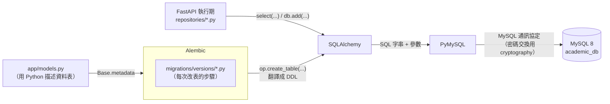
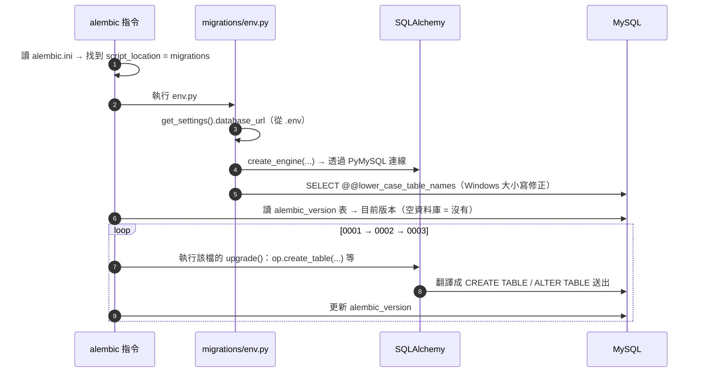
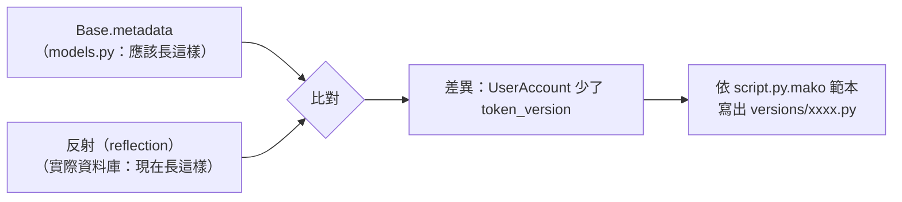
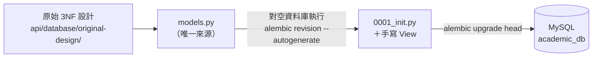

# SQLAlchemy、Alembic 與資料庫建立筆記

這份筆記說明本專案中「和資料庫有關的套件」各自在做什麼，資料庫是怎麼從零被建出來的，以及 `api/app/models.py` 與第一版 migration 是怎麼寫、怎麼來的。例子都取自本專案。

---

## 0. 一張圖看懂：誰負責什麼



| 套件／元件                  | 一句話說明                                                                                                                                                     | 在本專案的位置                                           |
| --------------------------- | -------------------------------------------------------------------------------------------------------------------------------------------------------------- | -------------------------------------------------------- |
| **MySQL 8**           | 真正存資料、執行 SQL、強制約束的資料庫伺服器                                                                                                                   | 本機安裝的服務；資料庫名稱`academic_db`                |
| **PyMySQL**           | 驅動程式（driver）：負責「連上 MySQL、把 SQL 送過去、把結果拿回來」                                                                                            | `requirements.txt`；`DATABASE_URL` 中的 `+pymysql` |
| **cryptography**      | PyMySQL 的相依套件：MySQL 8 預設的登入驗證方式`caching_sha2_password` 需要它做加密                                                                           | `requirements.txt`                                     |
| **SQLAlchemy**        | 把 Python 物件與 SQL 互相轉換的工具組（ORM + SQL 產生器 + 連線池）                                                                                             | `app/models.py`、`app/db.py`、`app/repositories/`  |
| **Alembic**           | 資料庫結構的版本控制：記錄「資料表怎麼一步一步變成現在這樣」並負責套用。SQLAlchemy 官方的資料庫遷移（migration）工具，負責「用版本控管的方式修改資料庫結構」。 | `alembic.ini`、`migrations/`                         |
| **pydantic-settings** | 從`.env` 讀出 `DATABASE_URL` 並驗證格式                                                                                                                    | `app/config.py`                                        |

最重要的觀念：

- **SQLAlchemy 不會自己建表**，它只「描述」資料表，並負責把描述翻譯成 SQL。
- **Alembic 才是建表、改表的那一位**，而它的 migration 底層仍然靠 SQLAlchemy 產生 SQL、靠 PyMySQL 送出。
- **兩者都不會建立資料庫本身**（`CREATE DATABASE`），那一步要在 MySQL 手動做一次。

---

## 1. 從零建出資料庫：每一步是誰在做事

README 的步驟只有幾行，但背後每一行都牽涉不同套件：

```powershell
# 0. 在 MySQL 裡手動建立空的資料庫（只做一次）
CREATE DATABASE academic_db CHARACTER SET utf8mb4 COLLATE utf8mb4_unicode_ci;

# 在 api\ 下
Copy-Item .env.example .env      # 1. 填入 DATABASE_URL
alembic upgrade head             # 2. 建立資料表與 View
python -m seed                   # 3. 寫入種子資料
uvicorn app.main:app --port 8000 # 4. API 開始讀寫資料庫
```

### 步驟 0：`CREATE DATABASE`（MySQL 自己）

Alembic 與 SQLAlchemy 都需要「先連得上一個資料庫」才能工作，而連線字串裡就寫著資料庫名稱，所以空的 `academic_db` 必須先存在。這裡指定的 `utf8mb4_unicode_ci` 和 `models.py` 中 `TABLE_OPTIONS` 的設定一致。

### 步驟 1：`DATABASE_URL`（pydantic-settings）

```text
mysql+pymysql://帳號:密碼@localhost:3306/academic_db
└┬──┘ └──┬──┘
 方言    驅動
```

- `mysql`：SQLAlchemy 的**方言（dialect）**，決定產生的 SQL 要用 MySQL 的語法（例如 `TINYINT`、`ENUM`、反引號）。
- `pymysql`：要用哪一個**驅動程式**送出 SQL。同樣是 MySQL，也可以換成 `mysqlclient` 等其他驅動，models 完全不用改。
- `app/config.py` 用 `Field(pattern=r"^mysql\+pymysql://")` 驗證格式，填錯時程式一啟動就失敗，不會跑到一半才出錯。

### 步驟 2：`alembic upgrade head`（Alembic → SQLAlchemy → PyMySQL）



執行時看到的這兩行 log，意思是：

```text
INFO  [alembic.runtime.migration] Context impl MySQLImpl.
INFO  [alembic.runtime.migration] Will assume non-transactional DDL.
```

- `MySQLImpl`：Alembic 偵測到方言是 MySQL，會用 MySQL 的語法產生 DDL。
- `non-transactional DDL`：MySQL 的 `CREATE TABLE`、`ALTER TABLE` 執行後會**自動 commit**，無法 rollback。所以 migration 執行到一半失敗時，前面已建好的表會留著，要手動處理（這點和 PostgreSQL 不同）。

### 步驟 3：`python -m seed`（SQLAlchemy）

`api/seed/__main__.py` 用兩種方式寫資料：

- `db.execute(text(statement))`：把 `seed.sql` 的每一句原樣交給資料庫（SQLAlchemy 的 Core 層）。
- `UserAccount(username=..., password_hash=...)`、`t.user = UserAccount(...)`：用 ORM 物件建立帳號，SQLAlchemy 在 flush 時自動產生 `INSERT`，並把新帳號的 `user_id` 回填到 `Teacher.user_id`。

`python -m seed --reset` 會在程式裡呼叫 Alembic 的 API（`command.downgrade(cfg, "base")` → `command.upgrade(cfg, "head")`），等同手動執行兩個 alembic 指令。

### 步驟 4：API 執行期（SQLAlchemy）

`app/db.py` 建立全程式共用的 `engine`（連線池）與 `SessionLocal`。每個 HTTP 請求透過 `get_db()` 拿到一個 `Session`，repositories 在裡面查詢。這一層和「建立資料庫」無關，見 §3.1 的說明。

---

## 2. MySQL、PyMySQL、cryptography：最底層的連線

| 層           | 職責                                                                                                          | 不知道的事                                        |
| ------------ | ------------------------------------------------------------------------------------------------------------- | ------------------------------------------------- |
| MySQL        | 解析 SQL、存資料、檢查約束（UNIQUE、FK、CHECK）、處理鎖                                                       | 不知道 Python 物件是什麼                          |
| PyMySQL      | 依 Python 的**DB-API 2.0** 標準介面（`connect()`、`cursor.execute()`、`fetchall()`）和 MySQL 溝通 | 不知道資料表長什麼樣子，只負責傳送 SQL 字串與參數 |
| cryptography | 提供 RSA／SHA-256 等加密運算                                                                                  | 只在登入資料庫的驗證交換時用到                    |

為什麼需要 cryptography：MySQL 8 的預設驗證外掛是 `caching_sha2_password`。在沒有 TLS 的連線上（本機開發就是這樣），伺服器重啟後的第一次登入要用 RSA 公鑰加密密碼，PyMySQL 把這段運算交給 cryptography。少了它，連線會在驗證階段失敗。

> 理論上可以只用 PyMySQL 寫整個專案：自己組 SQL 字串、自己把結果轉成 dict。SQLAlchemy 與 Alembic 解決的是「這樣寫會很累、很容易錯」的問題。

---

## 3. SQLAlchemy

### 3.1 SQLAlchemy 的三個元件：ORM、SQL 產生器、連線池

SQLAlchemy 不是單一功能，而是三個元件疊在一起：

```text
repositories/*.py（我們寫的程式）
      │
      ▼
① ORM          物件 ⇄ 資料列
      ▼
② SQL 產生器   Python 寫的查詢 → SQL 字串
      ▼
③ 連線池       借用已經連好的資料庫連線
      ▼
PyMySQL → MySQL
```

| 元件          | 一句話                                                                 | 本專案在哪裡                      |
| ------------- | ---------------------------------------------------------------------- | --------------------------------- |
| ① ORM        | 查出來的是`Student` 物件；改物件的屬性，commit 時自動變成 `UPDATE` | `models.py` 的類別、`Session` |
| ② SQL 產生器 | 用`select()`、`.where()` 組查詢，自動轉成 MySQL 語法的 SQL         | `repositories/`                 |
| ③ 連線池     | 事先連好幾條連線，請求來了就借、用完歸還                               | `app/db.py` 的 `engine`       |

官方文件把 ② 和 ③ 合稱 **Core**，① 稱為 **ORM**；ORM 建在 Core 之上。

#### ① ORM：一列資料 = 一個物件

```python
# 退選（services/enrollment_service.py，簡化）
enrollment = enrollment_repository.get(db, student_id, section_id)  # 查出一個 Enrollment 物件
enrollment.status = EnrollmentStatus.Withdrawn                      # 改屬性
db.commit()                                                          # SQLAlchemy 自動產生 UPDATE
```

不用自己寫 `UPDATE`，也不用自己把查詢結果轉成物件。負責記住「哪些物件被改過」的是 `Session`。

#### ② SQL 產生器：用 Python 組 SQL

```python
# student_repository.lock
select(Student).where(Student.student_id == "S001").with_for_update()
```

實際產生的 SQL：

```sql
SELECT `Student`.student_id, `Student`.student_name, ... FROM `Student`
WHERE `Student`.student_id = %s FOR UPDATE
-- 參數：'S001'
```

- 值變成 `%s`，和 SQL 分開送給 PyMySQL，所以不會有 SQL Injection。
- 複雜的條件也組得出來，例如依領域篩選的 `exists()`（`section_repository._has_field`）會產生 `EXISTS (SELECT * FROM CurriculumField WHERE ...)`。
- 想看某個查詢會變成什麼 SQL：`print(stmt.compile(dialect=mysql.dialect()))`（`from sqlalchemy.dialects import mysql`）。

#### ③ 連線池：重複使用連線

每次連 MySQL 都要建立連線、驗證帳密，很花時間。`app/db.py` 的 `create_engine(...)` 會建立一個連線池，重複使用連好的連線：

| 設定                   | 值         | 意思                                                   |
| ---------------------- | ---------- | ------------------------------------------------------ |
| 常駐連線數             | 5（預設）  | 平常保留 5 條連線                                      |
| 尖峰時可再多開         | 10（預設） | 同時請求很多時，最多再臨時開 10 條                     |
| `pool_recycle=3600`  | 1 小時     | 連線用滿 1 小時就換新的，避免被 MySQL 因閒置太久而斷線 |
| `pool_pre_ping=True` | —         | 借出前先確認連線還活著                                 |

一個 HTTP 請求的流程：`get_db()` 開一個 Session → 第一次查詢時向池子借連線 → 請求結束、Session 關閉 → 連線還回池子（不會斷線）。

### 3.2 查詢與寫入的常用寫法

**Session + models 類別**就是操作資料庫用的物件：Session 負責連線與交易，models 類別描述要查哪張表、哪些欄位。

| 要做的事                   | SQLAlchemy                                                                 |
| -------------------------- | -------------------------------------------------------------------------- |
| 建立                       | `app/db.py` 的 `engine` + `SessionLocal`                             |
| 用主鍵查一筆               | `db.get(Student, "S001")`                                                |
| 條件查詢                   | `db.scalars(select(Section).where(Section.semester_id == "1151")).all()` |
| 新增                       | `db.add(Enrollment(...))` + `db.commit()`                              |
| 鎖定查詢（`FOR UPDATE`） | `select(...).with_for_update()`                                          |
| 原始 SQL                   | `db.execute(text("..."))`                                                |

models 類別本身就是 Python 類別，`Student`、`Student.student_id` 可以直接用在查詢裡，型別也直接寫在 `Mapped[...]` 中，不需要另外產生程式碼。

#### Session 與 Transaction（交易）的差別

兩者不是同一個東西，可以先這樣理解：

- **Session 是操作資料庫的工作空間**：負責執行 SQL、追蹤 ORM 物件的狀態，並維護 Identity Map。
- **Transaction 是工作空間裡的一次完整操作**：其中的資料異動必須一起成功或一起取消。

例如轉帳時，「從 A 扣款」和「替 B 加款」必須放在同一個 Transaction。若只完成其中一步，資料就會不一致。

| 項目 | Session | Transaction |
| --- | --- | --- |
| 主要用途 | 管理 ORM 物件、執行 SQL、維護 Identity Map | 保證一組資料庫操作一起成功或一起失敗 |
| 開始時機 | 建立 `Session` 物件時 | SQLAlchemy 通常在第一次執行 SQL 時自動開始（autobegin） |
| 結束方式 | `db.close()`，或離開 Session 的 `with` 區塊 | `commit()` 確認變更，或 `rollback()` 取消尚未提交的變更 |
| 彼此關係 | 同一個 Session 可以先後執行多個 Transaction | 一個 Transaction 只代表這一次要一起處理的操作 |

```text
建立 Session
│
├─ Transaction ①：查詢學生 → 修改學生 → commit（正式保存）
│
├─ Transaction ②：查詢教師 → 發生錯誤 → rollback（取消變更）
│
└─ 關閉 Session
```

可以用 `with db.begin()` 明確標示一個 Transaction 的範圍：

```python
with db.begin():
    student = db.get(Student, "S001")
    student.status = StudentStatus.Suspended

# 正常離開 with：自動 commit
# 區塊內發生例外：自動 rollback
```

`db.close()` 是關閉 Session，不等於 commit。若關閉時還有未結束的 Transaction，SQLAlchemy 會 rollback，不會自動替程式保存尚未提交的變更。

簡單比喻：Session 是辦公桌，Transaction 是桌上正在處理的一份案件；`commit` 是確認送出，`rollback` 是取消案件，`close` 是清理並關閉整張辦公桌。

#### 悲觀鎖（Pessimistic Locking）與 `FOR UPDATE`

悲觀鎖的想法是：「預期同一筆資料可能同時被多人修改，所以先鎖定，再檢查及修改。」它主要用來避免 Race Condition（競態條件）、超賣與 Lost Update（遺失更新）。

「悲觀」不是指情緒，而是一種保守假設：程式先假設「我處理資料的期間，很可能有人也要修改它」。因此，在執行「讀取 → 判斷 → 修改」之前，會先請資料庫暫時鎖住目標資料列：

- 目前的 Transaction 可以繼續檢查及修改這筆資料。
- 其他 Transaction 若也要修改、刪除或鎖定同一筆資料，通常必須等待。
- 目前的 Transaction `commit()` 或 `rollback()` 後，資料庫就會釋放鎖。

簡單比喻：只剩一張選課申請表時，A 先拿走並在櫃檯處理；B 不能同時拿同一張表，只能等 A 完成或取消。這個「先保留給一個人處理」的做法，就是悲觀鎖。

悲觀鎖是**資料庫的併發控制機制**，不是 Python 的 Thread Lock，也不是 Session 自動提供的功能。Session 負責執行查詢；程式必須透過 `FOR UPDATE` 明確要求資料庫加鎖，而鎖實際上屬於目前的 Transaction。

| 查詢方式 | 意義 |
| --- | --- |
| 一般 `SELECT` | 只讀取資料，不先保留修改權；兩個請求可能同時讀到相同舊值 |
| `SELECT ... FOR UPDATE` | 讀取並鎖定目標資料列，讓需要修改同一筆資料的其他 Transaction 等待 |

SQLAlchemy 的 `.with_for_update()` 會產生概念上如下的 SQL：

```sql
SELECT *
FROM Student
WHERE student_id = :student_id
FOR UPDATE;
```

- `SELECT *`：讀取符合條件資料列的全部欄位。
- `FROM Student`：從 `Student` 資料表查詢。
- `WHERE student_id = :student_id`：只找指定學號；`:student_id` 是稍後由 SQLAlchemy 安全帶入的參數，不是固定文字。
- `FOR UPDATE`：讀取資料的同時鎖定符合條件的資料列，表示目前 Transaction 接下來準備修改它。

以課程只剩一個名額為例：

1. Transaction A 使用 `FOR UPDATE` 讀取班級，取得該資料列的鎖，確認還有一個名額。
2. Transaction B 也使用 `FOR UPDATE` 讀取同一個班級，但因 A 尚未結束，所以必須等待。
3. A 建立選課紀錄並 `commit()`；資料正式保存，同時釋放鎖。
4. B 繼續執行，讀到最新資料並發現名額已滿，因此不能再建立選課紀錄。

若兩邊都先用一般 `SELECT` 查詢，就可能同時看到「剩一個名額」，接著都通過檢查，造成超收。類似情況也可能造成 Lost Update：兩個 Transaction 都依照舊值計算新值，後寫入的一方覆蓋先前結果，使其中一次業務操作沒有正確反映在資料中。

`FOR UPDATE` 的鎖從查詢成功取得後開始，持續到目前 Transaction `commit()` 或 `rollback()` 為止：

```text
Transaction 開始
    ↓
SELECT ... FOR UPDATE（取得資料列鎖）
    ↓
檢查條件並修改資料
    ↓
commit 或 rollback（Transaction 結束並釋放鎖）
```

使用悲觀鎖時要注意：

- **必須放在同一個 Transaction 中**：如果 SQL 執行完就立刻提交，鎖也會立刻釋放，無法保護後續的檢查與修改。
- **一般 `SELECT` 通常仍可讀取**：其他 Transaction 通常是修改、刪除或再次以 `FOR UPDATE` 鎖定同一筆資料時才需要等待；實際行為仍受資料庫與隔離等級影響。
- **查詢條件應命中索引**：例如 `student_id` 是主鍵，資料庫能準確找到並鎖定目標。若沒有適當索引，InnoDB 可能掃描並鎖住大量索引紀錄或範圍，造成近似鎖住整張表的效能問題，但不代表一定會直接使用 Table Lock。
- **Transaction 要盡量短**：取得鎖後不要執行耗時的網路請求或等待使用者輸入，否則其他請求會長時間卡住。
- **所有流程使用一致的加鎖順序**：例如都先鎖學生、再鎖班級，降低兩個 Transaction 互相等待而產生 Deadlock（死結）的風險。
- **仍要處理 Deadlock 或逾時**：資料庫偵測到 Deadlock 時，通常會中止其中一個 Transaction；程式必須 rollback，並視業務需求決定是否重試。

#### `add()`、`flush()`、`commit()` 與 `rollback()`

Transaction（交易）是一組要一起成功或一起取消的資料庫操作。例如建立使用者時，可能同時新增帳號、回填教師的 `user_id`、寫入稽核紀錄；若中途失敗，不應只留下其中一部分。

```text
db.add()
   ↓
物件加入 Session，成為 pending
   ↓
flush
   ↓
SQL 已送到資料庫執行，但仍在 Transaction 中
   ↓
commit：正式保留全部變更
或
rollback：取消尚未 commit 的變更
```

| 操作 | 意義 |
| --- | --- |
| `db.add(obj)` | 把 ORM 物件交給 Session 追蹤，不保證此刻已執行 `INSERT` |
| `db.flush()` | 立即送出尚未執行的 `INSERT`／`UPDATE`／`DELETE`，但不結束 Transaction |
| `db.commit()` | commit 前先自動 flush，再確認整個 Transaction，讓變更正式保留 |
| `db.rollback()` | 取消目前 Transaction 中尚未 commit 的變更 |

`flush()` 常用在同一個 Transaction 中必須先取得資料庫產生值的情況，例如自動遞增主鍵：

```python
admin = UserAccount(username="admin", ...)
db.add(admin)
db.flush()  # INSERT 已執行，因此現在可以取得 admin.user_id；但仍未 commit

db.add(TeacherPermissionLog(changed_by=admin.user_id, ...))
```

如果後面不需要立刻使用新資料的主鍵，就不必手動 `flush()`；離開 `db.begin()` 時，commit 前會自動 flush：

```python
with Session(engine) as db, db.begin():
    db.add(TeacherPermissionLog(...))
    # 正常離開：自動 flush → commit
    # 發生例外：rollback，不留下只完成一半的資料
```

上面的多重 context manager 等同於巢狀寫法：

```python
with Session(engine) as db:
    with db.begin():
        ...
```

離開時順序相反：先結束 `db.begin()`，完成 commit 或 rollback；再執行 `Session.close()`，釋放 Session 持有的連線與 ORM 狀態。

這裡的 commit 是「資料庫 Transaction 的提交」，與 Git commit 不同：

| 名稱 | 保存內容 |
| --- | --- |
| 資料庫 commit | 確認 `INSERT`、`UPDATE`、`DELETE` 等資料變更 |
| Git commit | 保存程式碼與文件的版本紀錄 |

> 注意：以上 rollback 說明主要適用於一般資料異動（DML）。MySQL 的 `CREATE TABLE`、`ALTER TABLE` 等 DDL 會自動 commit，通常無法 rollback。

### 3.3 為什麼 `select(User)` 的第一個結果元素是完整 ORM 物件

SQLAlchemy 會依照 `select(...)` 中傳入的項目，決定查詢結果每一列（`Row`）包含哪些**結果元素**。這裡的結果元素不一定等同於資料庫的一個實體欄位：傳入單一欄位時，結果元素就是該欄位的值；傳入 ORM model 類別時，結果元素則是由多個資料庫欄位組裝而成的完整 ORM 物件。

#### 傳入個別欄位

```python
stmt = select(User.name, User.email)
row = db.execute(stmt).first()
```

底層 SQL 會查詢兩個欄位：

```sql
SELECT users.name, users.email FROM users;
```

假設第一筆資料是 Alice，`row` 的內容概念上就是：

```python
("Alice", "alice@example.com")
```

- `row[0]` 是 `User.name` 的字串值 `"Alice"`。
- `row[1]` 是 `User.email` 的字串值 `"alice@example.com"`。

#### 傳入完整 ORM model

```python
stmt = select(User)
row = db.execute(stmt).first()
```

底層 SQL 仍會展開並讀取建立 `User` 物件所需的欄位：

```sql
SELECT users.id, users.name, users.email FROM users;
```

但 SQLAlchemy ORM 會利用這些欄位建立一個 `User` 實例，所以 `row` 概念上是只含一個結果元素的 tuple：

```python
(<User id=1 name="Alice">,)
```

因此 `row[0]` 不是 `users.id`，而是完整的 `User` ORM 物件。SQLAlchemy 已替程式完成組裝，不需要手動撰寫 `User(id=row[0], name=row[1], ...)`。

> 更精確地說，`User` 是 `Row` 中的一個**結果元素**，不是資料庫實體表中的單一欄位。把它口語稱為「第 0 欄」雖然容易理解，但可能讓人誤以為它只對應一個 SQL 欄位。

#### 同一列可以同時包含 ORM 物件與欄位值

```python
stmt = select(User, Order.price).join(Order, Order.user_id == User.id)
row = db.execute(stmt).first()
```

每一列會包含兩個結果元素：

| 位置 | `select(...)` 中的項目 | Python 結果 |
| --- | --- | --- |
| `row[0]` | `User` | 完整的 `User` ORM 物件，例如 `<User id=1 name="Alice">` |
| `row[1]` | `Order.price` | 單一欄位值，例如 `250` |

整列概念上就是：

```python
(<User id=1 name="Alice">, 250)
```

#### `execute()`、`scalar()` 與 `scalars()` 的關係

`execute()` 會保留每一列的完整結構；`scalar()` 與 `scalars()` 則取出每列的第一個結果元素：

```python
stmt = select(User)

db.execute(stmt).first()  # (<User Alice>,)：第一列，保留 Row 結構
db.scalar(stmt)           # <User Alice>：第一列的第一個結果元素
db.scalars(stmt).all()    # [<User Alice>, <User Bob>]：每列的第一個結果元素
```

同一套規則也適用於欄位與運算式：

```python
db.scalar(select(User.name))  # 第一列的 name 字串
db.scalar(select(func.count()).select_from(User))  # 計算後的數字
```

若查詢同時選取多個項目，例如 `select(User, Order.price)`，使用 `scalars()` 只會保留第一個項目 `User`，`Order.price` 會被捨棄。需要兩者時應使用 `execute()` 逐列讀取完整的 `Row`。

總結：

- `select(User.name)`：每列第一個結果元素是欄位值。
- `select(User)`：每列第一個結果元素是由多個資料庫欄位組裝出的 `User` ORM 物件。
- `select(User, Order.price)`：每列同時包含一個 `User` ORM 物件與一個數值。

這正是 ORM 的便利：應用程式可以直接操作代表一筆資料的 Python 物件，而不必自行把分散的 SQL 欄位轉換成物件。

### 3.4 SQLAlchemy 的 Session 不是登入的 session

兩者只是剛好都叫 session，是完全不同的東西：

|              | SQLAlchemy 的 Session                                     | 登入的 session（JWT）                                        |
| ------------ | --------------------------------------------------------- | ------------------------------------------------------------ |
| 解決的問題   | 這次要對資料庫做哪些讀寫                                  | 這個使用者是誰、有沒有登入                                   |
| 存在哪裡     | 後端記憶體                                                | 瀏覽器的 cookie`access_token`                              |
| 存活時間     | 一個 HTTP 請求（`get_db()` 開啟、請求結束關閉）         | 8 小時，到期或登出為止                                       |
| 內容         | 借來的資料庫連線、目前的交易、讀出或改過的 ORM 物件       | `sub`、`username`、`role`、`ver` 等身分資訊          |
| 本專案的程式 | `app/db.py` 的 `SessionLocal`、各處的 `db: Session` | `app/session.py`（簽發、驗證 JWT）、`web/lib/session.ts` |
| 碰不碰資料庫 | 就是用來讀寫資料庫的                                      | `app/session.py` 的函式都不查資料庫；但每個需登入的請求，`require_auth` 驗證 JWT 後會另外查一次帳號的 `is_active` 與 `token_version`（`auth_service.ensure_session_valid`），這一步用的是 SQLAlchemy 的 Session |

> 容易搞混：`app/session.py` 處理的是 JWT 登入，跟 SQLAlchemy 的 Session 無關，檔名裡的 session 指的是「登入狀態」。檔案裡的每一個名稱都屬於登入這一邊：
>
> | 名稱 | 做什麼 |
> | --- | --- |
> | `CurrentUser` | 從 JWT 解出的登入者身分（dataclass） |
> | `create_token()` | 簽發 JWT |
> | `decode_token()` | 驗證 JWT 的簽章、簽發者與到期時間，還原成 `CurrentUser` |
> | `set_session_cookie()` | 在 HTTP 回應加上 `Set-Cookie`，讓瀏覽器把 JWT 存進 httpOnly cookie `access_token`。只是寫回應標頭，不碰資料庫。在 `routes/auth.py` 的兩個時機呼叫：登入成功、修改自己的密碼後重新簽發（讓目前裝置維持登入） |
> | `clear_session_cookie()` | 登出時刪除這個 cookie |

一個請求裡兩者同時出現，但各做各的：

```text
瀏覽器帶著 cookie（JWT）發出 POST /api/enrollments
  │
  ├─ require_auth：驗證 JWT → 知道「你是 S001」          ← 登入 session
  │
  └─ get_db()：開一個 SQLAlchemy Session
        → 鎖學生、鎖班級、INSERT Enrollment → commit     ← 資料庫 Session
        → 請求結束，Session 關閉、連線還回連線池
```

簡單說：**JWT 告訴後端「誰」在操作，SQLAlchemy Session 負責「怎麼」對資料庫操作。**

補充：傳統網站常說的「伺服器端 session」（伺服器記住登入狀態，cookie 裡只放一個 session ID）是 JWT 的替代方案，屬於登入那一邊。`系統架構筆記.md` §11.2 談 Token 撤銷時說的「改用伺服器端 session」指的就是這種，同樣和 SQLAlchemy 的 Session 無關。

### 3.5 `Base` 與 `metadata`：所有資料表的清單

```python
class Base(DeclarativeBase):
    """所有 ORM 模型的基底；Base.metadata 收集全部資料表，供 Alembic 比對"""
```

- 每個繼承 `Base` 的類別，在 Python 載入 `models.py` 時就會把自己的 `Table` 登記到 **`Base.metadata`**。
- `Base.metadata` 是一個記憶體中的物件，內容是「15 張資料表應該長什麼樣子」：欄位、型別、主鍵、外鍵、索引、約束。
- **它只是描述，不會連線、不會建表。** Alembic 的 `env.py` 用 `target_metadata = Base.metadata` 把這份描述拿去和真正的資料庫比對（§4.4）。

### 3.6 一張表怎麼寫：以 `Section` 為例

左邊是 `models.py`，右邊是它最後在 MySQL 產生的 DDL（取自 `api/database/schema.generated.sql`）：

```python
class Section(Base):
    __tablename__ = "Section"
    __table_args__ = table_args(
        UniqueConstraint("course_no", "semester_id", "section_code",
                         name="Section_course_no_semester_id_section_code_key"),
        UniqueConstraint("section_id", "semester_id", name="Section_section_id_semester_id_key"),
        Index("Section_semester_id_status_idx", "semester_id", "status"),
        CheckConstraint("capacity BETWEEN 1 AND 500", name="chk_section_capacity"),
    )

    section_id: Mapped[int] = mapped_column(Integer, primary_key=True, autoincrement=True)
    course_no: Mapped[str] = mapped_column(CHAR(5), fk("Course.course_no", "Section_course_no_fkey"))
    semester_id: Mapped[str] = mapped_column(CHAR(4), fk("Semester.semester_id", "Section_semester_id_fkey"))
    section_code: Mapped[str] = mapped_column(CHAR(2), server_default="01")
    capacity: Mapped[int] = mapped_column(SmallInteger)
    status: Mapped[SectionStatus] = mapped_column(_enum(SectionStatus), server_default="Open")
    created_by: Mapped[str | None] = mapped_column(
        CHAR(6), fk("Teacher.teacher_id", "Section_created_by_fkey", ondelete="SET NULL")
    )
    created_at: Mapped[datetime] = mapped_column(DateTime, server_default=NOW)

    course: Mapped[Course] = relationship()
    teachers: Mapped[list["SectionTeacher"]] = relationship(back_populates="section", cascade="all, delete-orphan")
```

```sql
CREATE TABLE `Section` (
    section_id INTEGER NOT NULL AUTO_INCREMENT,
    course_no CHAR(5) NOT NULL,
    semester_id CHAR(4) NOT NULL,
    section_code CHAR(2) NOT NULL DEFAULT '01',
    capacity SMALLINT NOT NULL,
    status ENUM('Open','Cancelled') NOT NULL DEFAULT 'Open',
    created_by CHAR(6),
    created_at DATETIME NOT NULL DEFAULT CURRENT_TIMESTAMP,
    PRIMARY KEY (section_id),
    CONSTRAINT chk_section_capacity CHECK (capacity BETWEEN 1 AND 500),
    CONSTRAINT `Section_course_no_fkey` FOREIGN KEY(course_no) REFERENCES `Course` (course_no) ON DELETE RESTRICT ON UPDATE CASCADE,
    CONSTRAINT `Section_created_by_fkey` FOREIGN KEY(created_by) REFERENCES `Teacher` (teacher_id) ON DELETE SET NULL ON UPDATE CASCADE,
    CONSTRAINT `Section_semester_id_fkey` FOREIGN KEY(semester_id) REFERENCES `Semester` (semester_id) ON DELETE RESTRICT ON UPDATE CASCADE,
    CONSTRAINT `Section_course_no_semester_id_section_code_key` UNIQUE (course_no, semester_id, section_code),
    CONSTRAINT `Section_section_id_semester_id_key` UNIQUE (section_id, semester_id)
)CHARSET=utf8mb4 COLLATE utf8mb4_unicode_ci;

CREATE INDEX `Section_semester_id_status_idx` ON `Section` (semester_id, status);
```

逐項對照：

| models.py 的寫法                                     | 產生的 SQL                                                              | 說明                                                                      |
| ---------------------------------------------------- | ----------------------------------------------------------------------- | ------------------------------------------------------------------------- |
| `__tablename__ = "Section"`                        | `CREATE TABLE \`Section\``                                            | 資料表名稱；本專案一律 PascalCase                                         |
| `Mapped[int]`、`Mapped[str]`                     | `NOT NULL`                                                            | 型別標註**沒有** `None` → 不可為 NULL                            |
| `Mapped[str \| None]`                               | （可為 NULL）                                                           | `created_by` 允許 NULL（歷史資料沒有建立者）                            |
| `mapped_column(CHAR(5))`                           | `CHAR(5)`                                                             | 括號裡寫的是**資料庫型別**；`Mapped[...]` 是**Python 型別** |
| `primary_key=True, autoincrement=True`             | `PRIMARY KEY`、`AUTO_INCREMENT`                                     |                                                                           |
| `server_default="01"`                              | `DEFAULT '01'`                                                        | 預設值寫進 DDL，由資料庫產生（見下方說明）                                |
| `server_default=NOW`                               | `DEFAULT CURRENT_TIMESTAMP`                                           | `NOW = func.current_timestamp()`                                        |
| `_enum(SectionStatus)`                             | `ENUM('Open','Cancelled')`                                            | Python 的`StrEnum` 對應 MySQL 的 ENUM                                   |
| `fk("Course.course_no", "Section_course_no_fkey")` | `CONSTRAINT ... FOREIGN KEY ... ON DELETE RESTRICT ON UPDATE CASCADE` | `fk()` 是本專案的輔助函式（§3.7）                                      |
| `UniqueConstraint(...)`                            | `CONSTRAINT ... UNIQUE (...)`                                         | 名稱明確寫出                                                              |
| `Index(...)`                                       | `CREATE INDEX ...`                                                    |                                                                           |
| `CheckConstraint(...)`                             | `CONSTRAINT ... CHECK (...)`                                          | MySQL 8.0.16 起才真正強制執行                                             |
| `relationship(...)`                                | **（沒有任何 SQL）**                                              | 只存在於 Python 端，見下方說明                                            |
| `table_args(...)` 最後附上的 `TABLE_OPTIONS`     | `CHARSET=utf8mb4 COLLATE utf8mb4_unicode_ci`                          |                                                                           |

#### `server_default` 與 `default` 的差別

| 參數                   | 誰產生預設值                | 會不會寫進 DDL        | 本專案       |
| ---------------------- | --------------------------- | --------------------- | ------------ |
| `server_default=...` | MySQL                       | 會（`DEFAULT ...`） | 全部使用這個 |
| `default=...`        | SQLAlchemy 在 INSERT 時帶入 | 不會                  | 沒有使用     |

用 `server_default` 的好處：以原始 SQL 寫入資料時（例如 `seed.sql` 的 `INSERT`，ORM 不介入），預設值一樣有效。

例外是 `Enrollment.updated_at` 的 `onupdate=func.now()`：這是 SQLAlchemy 在**透過 ORM 更新這一列時**，自動在 `UPDATE` 敘述中加上 `updated_at = now()`。直接下 SQL 更新時不會生效。

#### `relationship()` 不會產生任何 SQL

`relationship` 是給 Python 程式「順著關係走」用的，不影響資料表結構：

```python
section.course.course_name          # 從班級拿到課程名稱，SQLAlchemy 自動查 Course
section.teachers                    # 這個班的 SectionTeacher 清單
t.user = UserAccount(...)           # seed 中：指派後 flush 時自動寫入 Teacher.user_id
```

真正在資料庫中建立關聯的是外鍵（`fk(...)`、`ForeignKeyConstraint`）。`cascade="all, delete-orphan"` 也只是 ORM 的行為：從 `course.fields` 清單移除一個物件，flush 時 SQLAlchemy 會替你下 `DELETE`。這和外鍵上的 `ON DELETE CASCADE`（由 MySQL 執行）是兩回事。

### 3.7 本專案自訂的三個輔助函式

```python
def table_args(*items):
    return (*items, TABLE_OPTIONS)        # 每張表都附上 utf8mb4_unicode_ci

def fk(target, name, *, ondelete="RESTRICT"):
    return ForeignKey(target, name=name, ondelete=ondelete, onupdate="CASCADE")

def _enum(cls):
    return Enum(cls, native_enum=True, validate_strings=True,
                values_callable=lambda e: [m.value for m in e])
```

- `table_args`：SQLAlchemy 規定 `__table_args__` 若是 tuple，資料表選項的 dict 必須放在最後一個。包成函式避免每張表都要記得這條規則。
- `fk`：外鍵一律 `ON UPDATE CASCADE`（主鍵值被修改時，子資料的外鍵跟著更新）；`ON DELETE` 預設 `RESTRICT`（仍有子資料參照時拒絕刪除，避免誤刪）。可為 NULL 的外鍵改傳 `SET NULL`，例如 `Section.created_by`：教師被刪除時保留班級，只清空建立者。需要連帶刪除時才傳 `ondelete="CASCADE"`。
- `_enum`：`values_callable` 讓資料庫存列舉的**值**（`"Open"`），而不是成員名稱。`validate_strings=True` 讓錯誤的字串在 Python 端就被擋下。

### 3.8 View 也寫成類別，但不由 SQLAlchemy 建立

```python
class SectionDetailView(Base):
    __tablename__ = "v_section_detail"
    __table_args__ = {"info": {"is_view": True}}
    section_id: Mapped[int] = mapped_column(Integer, primary_key=True)
    ...
```

- 寫成類別是為了**查詢方便**：`select(SectionDetailView).where(...)`、`db.get(SectionDetailView, 16)`。
- View 真正的定義是 migration 中手寫的 `CREATE VIEW ... AS SELECT ...`（`0001_init.py`、`0002_field_names.py`）。
- `info={"is_view": True}` 是給 Alembic 看的標記：比對時略過它，否則 Alembic 會以為「models 有一張叫 `v_section_detail` 的表，資料庫沒有」，然後產生 `CREATE TABLE`（見 §4.6 的 `include_object`）。

### 3.9 為什麼不用 `Base.metadata.create_all()`

SQLAlchemy 本身有一個 `create_all()`，可以依 models 直接建表。本專案**禁止使用**，原因：

| `create_all()`                                                   | Alembic                                  |
| ------------------------------------------------------------------ | ---------------------------------------- |
| 只會建立「還不存在」的表；表已存在時，欄位改了也**不會修改** | 可以新增欄位、改型別、加索引……         |
| 沒有版本紀錄，不知道資料庫目前是哪個版本                           | `alembic_version` 記錄目前版本         |
| 無法還原                                                           | 每個 migration 都有`downgrade()`       |
| 不會建立 View                                                      | migration 中可用`op.execute()` 建 View |

`create_all()` 適合寫完即丟的小工具或測試，不適合需要持續改表的專案。

---

## 4. Alembic

Alembic 由 SQLAlchemy 的作者開發，定位是「**資料庫結構的 git**」：每次改表都是一個 migration 檔，按順序串成歷史；資料庫裡記著目前套用到哪一版。

### 4.1 檔案結構

```text
api/
├─ alembic.ini                 Alembic 的設定檔：migration 放在哪、log 格式（必須純 ASCII）
└─ migrations/
   ├─ env.py                   每次執行 alembic 指令都會跑的腳本：怎麼連線、拿什麼來比對
   ├─ script.py.mako           產生新 migration 檔時用的範本
   └─ versions/
      ├─ 0001_init.py          15 張表、CHECK 約束、2 個 View
      ├─ 0002_field_names.py   兩個 View 加上 field_names 欄位
      └─ 0003_token_version.py UserAccount 新增 token_version
```

`migrations/` 不是 Python 套件（沒有 `__init__.py`），由 `alembic` 指令依 `alembic.ini` 的 `script_location` 載入。詳見 `Python 模組、套件與特殊名稱.md` §5。

### 4.2 一個 migration 檔長什麼樣子：以 0003 為例

```python
revision: str = '0003'          # 這個版本的 ID
down_revision = '0002'          # 它的上一個版本

def upgrade() -> None:
    op.add_column('UserAccount',
        sa.Column('token_version', sa.Integer(), server_default=sa.text('0'), nullable=False))

def downgrade() -> None:
    op.drop_column('UserAccount', 'token_version')
```

- `upgrade()`：從 0002 升到 0003 要做的事。
- `downgrade()`：從 0003 退回 0002 要做的事（必須能完全抵銷 `upgrade()`）。
- `op` 是 Alembic 的操作 API（`create_table`、`add_column`、`create_index`、`execute`……），由 SQLAlchemy 依方言翻譯成 SQL。上面這段在 MySQL 上會變成：

```sql
ALTER TABLE `UserAccount` ADD COLUMN token_version INTEGER NOT NULL DEFAULT 0;
UPDATE alembic_version SET version_num='0003' WHERE alembic_version.version_num = '0002';
```

第二行是 Alembic 自己加的：每套用一個 migration，就更新一次版本紀錄。

### 4.3 版本鏈與 `alembic_version` 表

`revision` / `down_revision` 把所有 migration 串成一條鏈：

```text
$ alembic history
0002 -> 0003 (head), UserAccount 新增 token_version
0001 -> 0002, View 加入課程領域欄位 field_names
<base> -> 0001, 初始結構：15 張資料表、CHECK 約束與 2 個 View

$ alembic current
0003 (head)
```

- `<base>`：完全沒有任何表的狀態。
- `head`：鏈的最末端（最新版）。
- 資料庫裡有一張 Alembic 自己建立的 **`alembic_version`** 表，只有一列、一個欄位 `version_num`，目前值是 `0003`。`upgrade head` 就是「從這裡往後，把還沒跑過的 migration 依序跑完」。
- Revision ID 預設是隨機的 12 碼十六進位字串（例如 `a1b2c3d4e5f6`），本專案改用 `0001`、`0002`、`0003` 流水號，比較好讀。真正決定順序的是 `down_revision`，不是檔名。

### 4.4 `--autogenerate`：自動比對產生 migration

改表時最常用的指令：

```powershell
alembic revision --autogenerate -m "UserAccount 新增 token_version"
```

它做的事情：



- **反射（reflection）**：SQLAlchemy 的 `Inspector` 去查 MySQL 的 `information_schema`，把現有的表、欄位、索引、外鍵讀回來，變成和 `Base.metadata` 同樣格式的物件。
- 比對兩者，把差異寫成 `op.add_column(...)` 等操作。
- **產生的檔案一定要人工檢查**。Alembic 自己在檔案中加了註解 `# please adjust!`，因為它可能誤判（例如把「改名」判成「刪掉舊欄位 + 新增新欄位」，資料會不見）。

autogenerate **偵測得到**：資料表與欄位的新增／刪除、欄位型別、可否為 NULL、`server_default`（本專案在 `env.py` 開啟了 `compare_server_default=True`）、索引、UNIQUE、外鍵。

autogenerate **偵測不到**，必須手寫：

| 項目             | 本專案的處理                                                                          |
| ---------------- | ------------------------------------------------------------------------------------- |
| CHECK 約束的變更 | 在 migration 中手動寫`op.drop_constraint(...)`／`op.create_check_constraint(...)` |
| View             | `op.execute("CREATE OR REPLACE VIEW ...")`，例如 `0002_field_names.py`            |
| 欄位改名         | 會被判成「刪除 + 新增」，要手動改成`op.alter_column(..., new_column_name=...)`      |
| 資料的搬移       | 例如拆欄位時要把舊資料轉過去，用`op.execute("UPDATE ...")`                          |

`0002_field_names.py` 就是完全手寫的 migration：它沒有改任何資料表，只用 `CREATE OR REPLACE VIEW` 替兩個 View 加上 `field_names` 欄位；`downgrade()` 再用一次 `CREATE OR REPLACE VIEW` 換回沒有該欄位的版本。

### 4.5 常用指令

| 指令                                          | 作用                                                                                                  |
| --------------------------------------------- | ----------------------------------------------------------------------------------------------------- |
| `alembic upgrade head`                      | 套用所有尚未執行的 migration                                                                          |
| `alembic downgrade -1`                      | 退回上一版（執行目前版本的`downgrade()`）                                                           |
| `alembic downgrade base`                    | 退回到完全沒有表（`seed --reset` 會用到，**資料全部消失**）                                   |
| `alembic current`                           | 查看資料庫目前的版本                                                                                  |
| `alembic history`                           | 列出整條版本鏈                                                                                        |
| `alembic revision --autogenerate -m "說明"` | 比對 models 與資料庫，產生新的 migration                                                              |
| `alembic revision -m "說明"`                | 產生空白的 migration（手寫 View 等內容時用）                                                          |
| `alembic upgrade head --sql`                | **離線模式**：不連資料庫，只把會執行的 SQL 印出來（`database/schema.generated.sql` 由此產生） |
| `alembic stamp <版本>`                      | 只把`alembic_version` 設成指定版本，**不執行任何 DDL**（資料庫已有相同結構、只需補上版本紀錄時使用） |

### 4.6 本專案對 `env.py` 做的客製化

`env.py` 由 `alembic init` 產生範本，本專案改了這幾處：

| 設定                                                   | 目的                                                                                                                |
| ------------------------------------------------------ | ------------------------------------------------------------------------------------------------------------------- |
| 連線字串取自`get_settings().database_url`            | 密碼留在`.env`，不寫進納入版控的 `alembic.ini`                                                                  |
| `target_metadata = Base.metadata`                    | 告訴 autogenerate：models.py 就是「應有的結構」                                                                     |
| `compare_type=True`、`compare_server_default=True` | 型別與預設值的差異也要比對                                                                                          |
| `include_object`（`app/migration_support.py`）     | ① 略過`info={"is_view": True}` 的 View 類別 ② 資料庫中有、models 沒定義的表（如 `alembic_version`）不提議刪除 |
| `patch_case_insensitive_reflection`                  | Windows MySQL 的表名存成小寫（`section`），反射結果要換回 `Section`，否則 autogenerate 會以為 15 張表全部不存在 |
| `poolclass=pool.NullPool`                            | migration 是一次性指令，不需要連線池                                                                                |

---

## 5. models.py 與 0001 是怎麼來的



1. **依原始 3NF 設計寫 models.py**：`api/database/original-design/` 保存最初的正規化設計。寫成 models.py 時把 `Course` 拆成課程庫 `Course` 與開課班級 `Section` 等（差異見該資料夾的 README）。約束與索引名稱全部明確寫出，採 `<表>_<欄位>_key／_idx／_fkey` 格式。
2. **建立空的資料庫**：§1 的步驟 0。
3. **產生 0001**：`alembic revision --autogenerate -m "初始結構"`。models 有 15 張表、資料庫一張都沒有，差異就是 15 個 `op.create_table(...)`；CHECK 約束跟著 `create_table` 一起輸出（autogenerate 偵測不到的是「修改」既有的 CHECK 約束）。
4. **手寫 View**：autogenerate 不處理 View，在 `# ### end Alembic commands ###` 之後以 `op.execute("CREATE VIEW ...")` 補上 `v_section_detail`、`v_student_transcript`；`downgrade()` 要先 `DROP VIEW` 再刪除資料表（View 依賴資料表）。
5. **套用與驗證**：`alembic upgrade head` 建表，`python -m seed` 寫入種子資料。再跑一次 `alembic revision --autogenerate`，應該產生**空的** migration，代表 models 與資料庫已一致（確認後把這個空檔刪掉）。
6. 之後的改動都走一般流程：0002（View 加領域，手寫）、0003（`token_version`，autogenerate，見 §6）。

autogenerate 只產生「models 與資料庫的差異」。若資料庫裡已經有同樣結構的表，差異為 0，產生的 migration 會是空的，所以第一版必須對空資料庫產生。

約束與索引的名稱一經建立就不要更改：改了名稱，autogenerate 會產生「刪除舊約束、建立新約束」的 migration，等於無意義地改動資料庫。

---

## 6. 實際改表的步驟（以 token_version 為例）

1. **改 models.py**：在 `UserAccount` 加上

   ```python
   token_version: Mapped[int] = mapped_column(Integer, server_default=text("0"))
   ```
2. **產生 migration**：

   ```powershell
   conda run -n academic_system --no-capture-output alembic revision --autogenerate -m "UserAccount 新增 token_version"
   ```
3. **檢查產生的檔案**：確認只有 `op.add_column`，沒有多出意料之外的操作（例如誤判要刪除某張表）。補上檔頭說明。
4. **確認 SQL（可選）**：`alembic upgrade head --sql` 看實際會執行的 DDL。
5. **套用**：`alembic upgrade head`。
6. **驗證**：`alembic current` 顯示 `0003 (head)`；再跑一次 `alembic revision --autogenerate`，應該產生**空的** migration（代表 models 與資料庫已一致），確認後把這個空檔刪掉。
7. 既有的帳號會由 `server_default` 補成 0，不需要另外寫資料轉換。

如果改的是 CHECK 約束（例如把 `chk_section_capacity` 的上限從 500 改成 300），第 2 步產生的檔案會是**空的**，必須自己寫：

```python
def upgrade() -> None:
    op.drop_constraint("chk_section_capacity", "Section", type_="check")
    op.create_check_constraint("chk_section_capacity", "Section", "capacity BETWEEN 1 AND 300")

def downgrade() -> None:
    op.drop_constraint("chk_section_capacity", "Section", type_="check")
    op.create_check_constraint("chk_section_capacity", "Section", "capacity BETWEEN 1 AND 500")
```

---

## 7. 本專案踩過的坑

| 現象                                                                  | 原因                                                                                            | 處理                                                           |
| --------------------------------------------------------------------- | ----------------------------------------------------------------------------------------------- | -------------------------------------------------------------- |
| autogenerate 說 15 張表全部「缺少」                                   | Windows MySQL`lower_case_table_names=1`，反射回來的表名是小寫                                 | `migration_support.patch_case_insensitive_reflection`        |
| `alembic upgrade`／`stamp` 顯示成功，`alembic_version` 卻是空的 | 偵測大小寫的查詢讓 SQLAlchemy 2.x autobegin 開了一個交易沒關，Alembic 以為是外部交易而不 commit | 偵測查詢包在自己的`with connection.begin():`                 |
| 所有 alembic 指令都`UnicodeDecodeError`                             | Windows 上 Alembic 以 cp950 讀`alembic.ini`，檔案裡有中文                                     | `alembic.ini` 維持純 ASCII，說明寫在 `env.py`              |
| migration 出現`SyntaxError: invalid non-printable character U+FEFF` | 用 PowerShell 5.1 的`>` 產生檔案，被加上 UTF-8 BOM                                            | 改由 Python 讀寫，或用 Git Bash 重導向                         |
| 更新課程領域時主鍵重複                                                | 「清空再全部加回」時，SQLAlchemy 在同一次 flush 中先 INSERT 後 DELETE                           | 只刪除不需要的、只新增新的（`course_service.update_course`） |

---

## 8. 名詞對照

| 名詞                              | 說明                                                                                        |
| --------------------------------- | ------------------------------------------------------------------------------------------- |
| ORM（Object-Relational Mapping）  | 讓一個 Python 物件對應資料表的一列，用物件操作代替手寫 SQL                                  |
| DDL（Data Definition Language）   | 定義結構的 SQL：`CREATE TABLE`、`ALTER TABLE`、`CREATE INDEX`                         |
| DML（Data Manipulation Language） | 操作資料的 SQL：`SELECT`、`INSERT`、`UPDATE`、`DELETE`                              |
| Migration                         | 一次結構變更的紀錄檔，含「怎麼升級」與「怎麼還原」                                          |
| Dialect（方言）                   | SQLAlchemy 對特定資料庫語法的支援，例如`mysql`、`postgresql`                            |
| Driver（驅動程式）                | 實際和資料庫連線的套件，例如 PyMySQL                                                        |
| DB-API 2.0                        | Python 規範的資料庫驅動標準介面（PEP 249）                                                  |
| Reflection（反射）                | 從現有資料庫讀回結構，變成 SQLAlchemy 的`Table` 物件                                      |
| `MetaData`                      | 一組`Table` 定義的集合；`Base.metadata` 收集了所有 models                               |
| Session                           | ORM 的工作單位：追蹤物件的變更，在 flush／commit 時轉成 SQL（不是登入的 session，見 §3.4） |
| flush                             | 把 Session 中尚未送出的變更送到資料庫（仍在交易中，尚未 commit）                            |
| Single Source of Truth            | 唯一來源；本專案中資料庫結構的唯一來源是`models.py`                                       |
